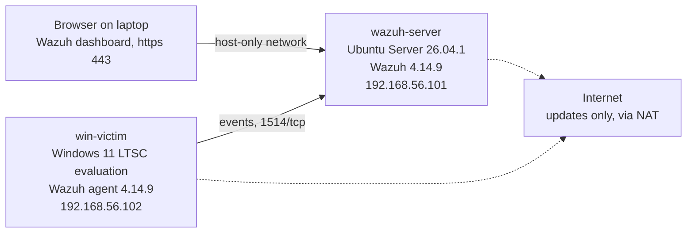
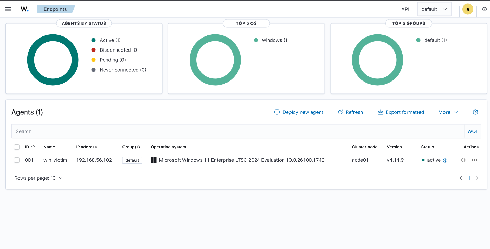
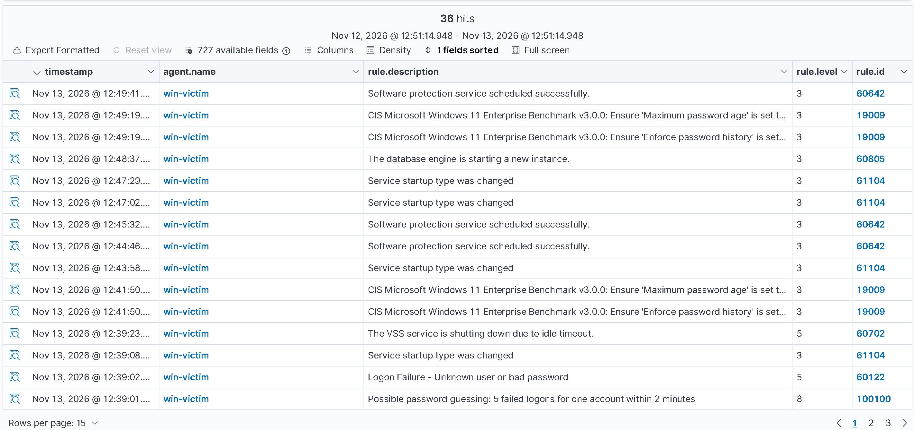
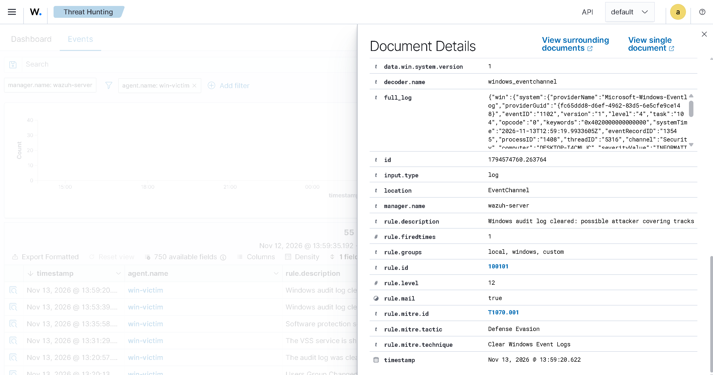

> Everything in this repository was done in a lab I built and own: two virtual machines on a private host-only network on my laptop. No system I do not own was touched. The only account used for attack simulation is a throwaway local account on my own Windows VM.

# SOC Home Lab: Wazuh SIEM, Windows detections and alert triage

A small SIEM lab built to practise the core loop of a SOC analyst's work: collect Windows logs, generate suspicious activity safely, see which alerts fire, write detection rules, and triage each alert in a short note.

**Status:** complete for this scope (3 attack scenarios, 2 custom rules, 3 analyst notes). Cost: 0 EUR.

## Architecture

Both VMs run in VirtualBox 7.2.22 on a 16 GB laptop. The lab network is host-only, so attack traffic stays on the laptop. Details: [architecture.md](architecture.md). Rebuild steps: [setup-steps.md](setup-steps.md).

## Detections

| Scenario | Windows event | Rule that fired | Built-in or mine | Level | ATT&CK |
|---|---|---|---|---|---|
| Repeated failed logons | 4625 | 60122, one per failure | built-in | 5 | T1531 (built-in tag) |
| | | **100100**, 5 failures on one account in 2 minutes | **custom** | 8 | T1110.001 |
| | | 60204, 8 failures from one source in 4 minutes | built-in | 10 | T1110 |
| | 4740 | 60115, account locked out | built-in | 9 | T1110, T1531 (built-in tags) |
| New local admin account | 4720, 4732 | 60109 (created), 60154 (Administrators changed) | built-in | 8, 12 | T1098, T1484 (built-in tags) |
| Security log cleared | 1102 | 63103 | built-in | 5 | T1070 |
| | | **100101**, same event raised to level 12 | **custom** | 12 | T1070.001 |

Rule cards: [detections/](detections/). Analyst notes (what happened, how I confirmed it, true or false positive, what I would do next): [analyst-notes/](analyst-notes/).

## Highlights

- Rule 100100 groups failures by **target account**, while built-in 60204 groups by **source address**. They catch different attacks, so they complement each other.
- Wazuh's built-in rule for a cleared log is only level 5. I raised it to level 12 with rule 100101.
- The current ATT&CK ID for clearing Windows event logs is T1685.005, but Wazuh 4.14.9's database still uses T1070.001. With the new ID the alert carried no MITRE fields. I switched to the older ID and documented it.
- Several built-in MITRE tags do not describe their events well (for example T1484 on a local group change).

## Lessons learned

Full version: [lessons-learned.md](lessons-learned.md).

- A VM that is 14 times too slow can have a host-level cause. A benchmark (57.7 s down to 4 s) located it: Windows' own hypervisor was running under VirtualBox.
- A frozen-looking install may be a paused process, a slow script or a real hang. Checking process state, CPU and logs separated them.
- On a 16 GB laptop, memory decides the design. I measured each VM's real cost before sizing the lab.
- Test activity must produce the event you expect. One method produced a single failed logon, another produced ten.

## Honest scope

- Most alerts come from Wazuh's built-in rules. I wrote two custom ones.
- 100100 was drafted with help from an AI assistant. 100101 I drafted, and the assistant reviewed it. I can explain both rules line by line.
- Wazuh 4.14.9 on Ubuntu 26.04.1 is not in the vendor's supported list for 4.14. I installed with the OS check ignored (`-i`).
- Two small VMs, one analyst, lab data only. No real incidents, no real network traffic.
- Not done: suspicious PowerShell detection, process-creation logging (Sysmon), a rule linking account creation to an admin change. See [detections/future-work.md](detections/future-work.md).

## How I used an AI assistant

I worked with an AI assistant (Claude) for explanations, troubleshooting and drafting the notes. I ran every command myself and checked the results against my own screenshots.

## Cost

0 EUR. Free and evaluation software only (VirtualBox, Ubuntu Server, Wazuh, Windows 11 Enterprise LTSC 90-day evaluation). No cloud service was used.

## Contents

- [architecture.md](architecture.md), [setup-steps.md](setup-steps.md), [lab-log.md](lab-log.md), [lessons-learned.md](lessons-learned.md)
- [detections/](detections/), [analyst-notes/](analyst-notes/), [screenshots/](screenshots/)
