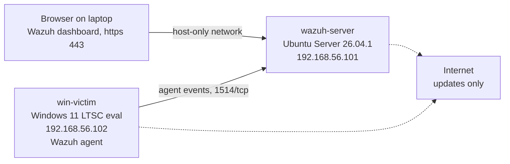

# Architecture

## Machines

| Machine | Role | OS | RAM | CPUs | Disk | Adapters |
|---|---|---|---|---|---|---|
| Host laptop | Runs VirtualBox, browser for the dashboard | Windows 11 | 16 GB LPDDR5 | Intel Core Ultra 7 155H | SSD | n/a |
| wazuh-server | Wazuh indexer, manager, Filebeat and dashboard (all-in-one) | Ubuntu Server 26.04.1 LTS | 4096 MB | 4 | 50 GB dynamic | NAT (internet), host-only 192.168.56.101 |
| win-victim | Monitored endpoint with Wazuh agent 4.14.9 | Windows 11 Enterprise LTSC 2024 evaluation, build 26100.1742 | 2560 MB | 2 | 64 GB dynamic | NAT (internet), host-only 192.168.56.102 |

VirtualBox 7.2.22. Software versions: Wazuh 4.14.9.

## Network

- **NAT adapters:** internet access for updates and the agent download. Each VM sees 10.0.2.15 on its own private NAT network. The two never talk over NAT.
- **Host-only network (192.168.56.0/24):** the lab network. Only the laptop and the two VMs are on it. No bridged adapter is used, so nothing is exposed to the home network.

## Diagram

## Data flow

1. Windows writes events to the Security log (for example 4625, failed logon).
2. The Wazuh agent on win-victim reads the log and sends events to the manager on port 1514/tcp.
3. The manager decodes the events and runs rules against them. A match becomes an alert.
4. Filebeat ships alerts to the indexer, and the dashboard reads them from there.
